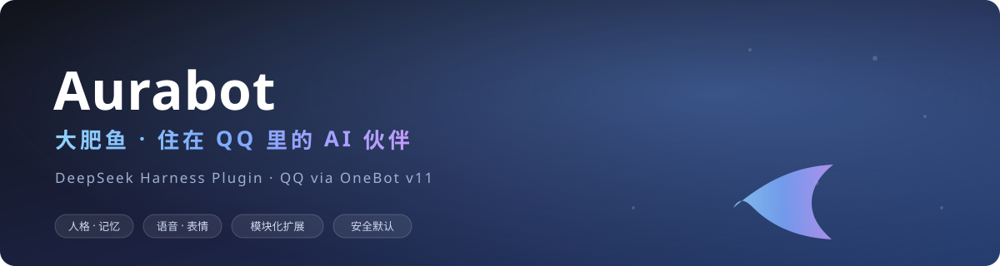

<div align="center">



**住在聊天平台里的 AI 伙伴「大肥鱼」· DeepSeek Harness 插件**

有人格、有心情、有记忆；能聊天、看图、发语音、发表情、唱歌。QQ 空间日记和 B 站浏览可从插件市场安装。

[English](README_EN.md) · **简体中文**

[](https://github.com/aureth-labs/dsh-aurabot-qq/releases)
[](LICENSE)
[](https://github.com/deepseek-ai/deepseek-harness)
[](https://github.com/botuniverse/onebot-11)
[](https://github.com/aureth-labs/dsh-aurabot-qq/stargazers)

</div>

## 这是什么

把 DeepSeek Harness 里的 AI 接进聊天平台：独立人格、记得住聊天细节、能接梗、发语音、唱歌、写空间。

框架本体是 **v2 内核 + 插件**：

- 消息统一走 `command → middleware → llm` 三段管线
- 平台差异全部交给适配器，内核只认元素树（与 Satori 对齐）
- 每项能力都是插件，注册的东西随插件卸载自动回收
- 前端是 DSH 的 React 面板，日志、插件、机器人都在里面管

```text
平台 ⇄ 适配器 ⇄ 管线（指令 / 中间件 / 模型）⇄ 插件
                                   ├─ 人格 · 心情 · 记忆
                                   └─ DSH 面板
```

## 快速开始

```bash
npm install
npm run build        # src → lib，client → dist
npm run dev          # 开发期：DSH 直接加载后端 TypeScript，面板增量构建
```

在 DSH 里启用本插件后打开面板。**没有设置向导**：进来就是主界面。

机器人连接在面板「机器人」页配置：OneBot v11、QQ 官方机器人、Satori 各是一份配置。
主人 ID、指令前缀、黑白名单在「全局配置」里。

## 聊天沙盒

不想先接 QQ 就用沙盒：内置的本地 Satori 服务 + 网页聊天室，出厂即开。

面板侧栏「聊天沙盒」直接打开，或在浏览器访问 `http://127.0.0.1:5140/`。
发一条消息，管线、插件、模型、回复全链路都会真实跑一遍。

## 目录

```text
src/                 内核：管线、消息、配置、存储、DSH 桥
packages/            内置插件：每个能力一个包
packages/adapters/   适配器：qq/{onebot-v11,qq-official}、satori
client/              面板前端（TS，打包成 dist/client.js）
lib/  dist/          构建产物，不进仓库
index.mjs            插件入口，只加载 lib/packages/app/index.js
```

## 自己写插件

在数据目录的 `modules/hello/index.ts` 写一个插件。用户在当前会话输入 `/hello`，就能收到 Schema 配置的问候语。

```ts
import { Schema, type Ctx } from '@aurabot/plugin-api'

export const name = 'hello'
export const config = Schema.object({ greeting: Schema.string().default('你好呀') })

export function apply(ctx: Ctx) {
  ctx.command('hello').action(({ session }) => session.send(ctx.config.greeting))
}
```

保存同包的 TypeScript 源文件时，宿主会释放旧实例并重新加载。单文件 ESM 小工具可以放在 `modules/<id>.mjs`。市场发行包带有 `package.json`、JS 入口和平台声明。开发接口与示例见 [插件 SDK](packages/sdk/API.md)。

## 开发

```bash
npm run dev          # 开发模式：起 DSH（8787）+ 前端 watch，插件直接跑 src/**/*.ts
npm run start        # 生产模式：起 DSH，插件走 lib/（编译产物）
npm run check        # tsc 两套配置 + 生命周期检查，和 VS Code 报错一致
npm run build
npm test             # 分域跑，别全量并发，会卡机器
```

- `dev` / `start` 的区别只有一个环境变量：`AURABOT_DEV=1` 时 `cordis.patch.yml` 把插件入口换成
  `dev.mjs`（静态 re-export `packages/app/index.ts`），改 `.ts` 保存即热重载；`start` 走 `index.mjs` → `lib/`，和用户装的包一致。
- 端口用 `DSH_PORT` 改，默认 8787；找不到 DSH 时用 `DSH_BIN` 指向 `.../@deepseek-ai/dsh/lib/bin.js`
- 调试输出走 `ctx.logger.debug`，只在面板打开「调试模式」时出现
- 日志文件在数据目录的 `logs/`，面板「日志」页可按文件查看

## 安全默认

- **总开关默认关**：不手动打开，真实平台一句话都不会发
- 沙盒是本地平台，不受总开关限制
- 群聊、非主人会话默认没有本机工具；敏感操作要「这一轮说话的人全是主人」才放行

## 反馈

问题直接开 issue：<https://github.com/aureth-labs/dsh-aurabot-qq/issues>

## License

[MIT](LICENSE)。第三方代码与素材见 [THIRD-PARTY-NOTICES.md](THIRD-PARTY-NOTICES.md)。
