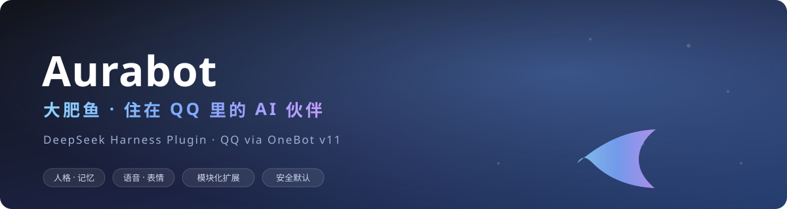

<div align="center">



**An AI companion living in chat platforms · DeepSeek Harness plugin**

[简体中文](README.md) · **English**

</div>

## What it is

Aurabot plugs DeepSeek Harness into chat platforms with a persistent persona, mood and memory.

v2 is a kernel plus plugins:

- every message goes through `command → middleware → llm`
- platform differences live in adapters; the kernel only knows an element tree (Satori-shaped)
- every capability is a plugin; registrations are disposed with it

```text
platform ⇄ adapter ⇄ pipeline ⇄ plugins
                        └─ DSH panel
```

## Quick start

```bash
npm install
npm run build
npm run dev      # watch: src → lib, client → dist; DSH hot-reloads
```

Enable the plugin in DSH and open the panel. There is **no setup wizard**: the panel opens on the
main view. Bot connections live on the "Bots" page; owner ids, command prefixes and allow lists are
global config.

## Chat sandbox

A built-in local Satori server plus a web chat room, enabled by default. Open "Chat sandbox" in the
sidebar or visit `http://127.0.0.1:5140/`. Messages exercise the real pipeline, plugins, model and
delivery path.

## Writing a plugin

Two forms, both hot-reload on save (release builds included):

| Form | Location | Use for |
| --- | --- | --- |
| single file | `<data>/modules/<id>.mjs` | keyword replies, link parsing |
| folder | `<data>/modules/<id>/index.ts` or `index.mjs` | multi-file, npm deps, panel pages |

```ts
export default {
  name: 'Hello',
  apply(ctx, config) {
    ctx.middleware(async (session, next) => {
      if (session.content.trim() !== 'hello') return next()
      await session.send('hi~')
    }, { name: 'hello' })
  },
}
```

See `API.md` and `aurabot.d.ts` in the data directory for the full `ctx` surface, element tree and
adapter contract. In-repo template: `packages/_template/`.

## Development

```bash
npm run check
npm run build
npm test
```

## Safety defaults

- Master switch is **off** by default: nothing is sent to a real platform until you turn it on
- The sandbox is local and not gated by the master switch
- Debug mode only affects log verbosity, never sending

## Issues

<https://github.com/aureth-labs/dsh-aurabot-qq/issues>

## License

[MIT](LICENSE)
